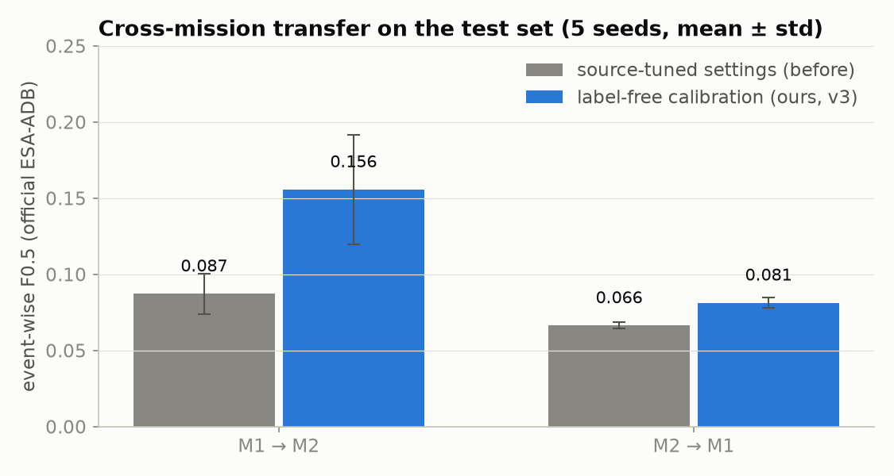
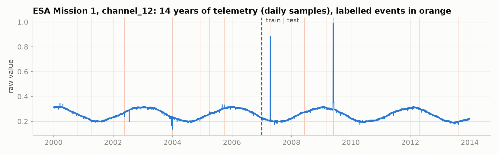
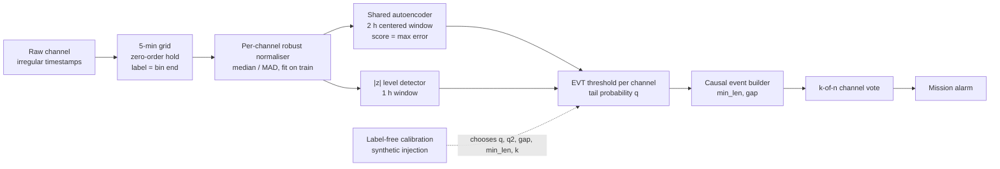
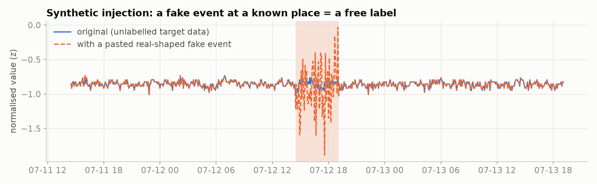
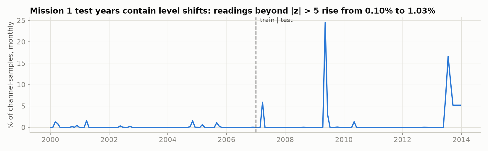

# Label-free cross-mission anomaly detection for spacecraft telemetry (ESA-ADB)

**Can an anomaly detector built on one satellite be deployed on a new satellite that has no labelled anomalies?**
This repository studies that question on the two real missions of the
[ESA Anomaly Detection Benchmark (ESA-ADB)](https://github.com/kplabs-pl/ESA-ADB). It uses the official
corrected event-wise F0.5 metric, the official train/test split and online (causal) detection throughout.

> **Status:** research in progress (target: IEEE SPACE 2027). Step 10 (baselines + improvement round) is done; see §5.3.
> Every design was frozen before its results were seen ([Step 9 log](notes/step9-design-frozen.md), [Step 10 protocol](notes/step10-protocol-frozen.md)).



## TL;DR
- **The model transfers; the settings don't.** On Mission 2, an autoencoder trained on Mission 1 matches Mission 2's own model (CV F0.5 0.860 vs 0.858). Transfer fails because post-processing settings (thresholds, event rules, channel voting) tuned on one mission are badly wrong on the other.
- **We propose label-free calibration by synthetic injection.** Replay real anomalies from the labelled *source* mission into the *unlabelled* target data, estimate how many real events hide in the target, and choose the settings that would score best.
- **Test-set result (official metric, 5 seeds):** M1→M2 improves from **0.087 to 0.156**, and M2→M1 from **0.066 to 0.081**. These are real but modest gains, far below what target labels allow (0.846 / 0.481).
- **Step 10 (post-hoc test, 4th use of test labels):** *fake-recall matching*, selected by a frozen rule, lifts M1→M2 to **0.386** but leaves M2→M1 at 0.081. Adding a *rolling* |z| lifts M2→M1 to **0.261**, close to the label-tuned 0.278. **No single method wins both directions.** Simple baselines (a fixed default, and Heydari et al. 2026) reach 0.89–0.93 on M1→M2 but collapse on M2→M1 (0.007–0.040).
- **Two negative findings, both measured:** (1) synthetic anomalies stay easier to catch than real ones, so the method is too cautious on Mission 2; (2) Mission 1's test years contain level shifts that a level-based detector can't survive and that calibration on the training years can't foresee.

---

## 1. Problem
Every new satellite starts its life with **no labelled anomalies**, so detectors can't be tuned on it. The obvious fix, training on an older mission and reusing the result, is what we test here.
We call train-on-A, test-on-B **transfer A→B**. ESA-ADB has two missions with very different behaviour:

| | Mission 1 | Mission 2 |
|---|---|---|
| Target channels | 58 | 47 |
| Training period | 84 months | 21 months |
| Labelled events in training (anomalies + rare events) | 105 (1.25 per month) | 282 (13.4 per month) |
| Typical event | long, few channels | about 1 h, about 19 channels |



## 2. Evaluation protocol (what makes the numbers trustworthy)
- **Metric:** the ESA-ADB corrected event-wise F0.5 (precision × TNR, β = 0.5). Our implementation is checked against the **official ESA-ADB code** and agrees to within 1e-17. Rare events and anomalies are both scored, as in the benchmark.
- **Split:** the official one (first half train, second half test). Test events are those overlapping the test period, as in the official code.
- **Online / causal:** no future samples (ESA-ADB p. 30). The 5-minute bins are labelled by their **end** time, and the event builder never back-dates or fills gaps backwards. We found and fixed two hidden future leaks of this kind (see [notes/step8](notes/step8-online-rules-and-sota-check.md)).
- **No tuning on test:** settings are chosen with **source** training labels (baseline) or with **no labels at all** (our method). Target labels are used only for diagnosis on the training period and for the final test.
- **Pre-registration:** every method version (v1–v4) was written down and frozen before its numbers were computed ([log](notes/step9-design-frozen.md)). Versions designed after looking at diagnostics are flagged as such. The test set was evaluated **once** for the method reported here.

## 3. Pipeline

- **Detector:** one small autoencoder (24 → 64 → 8 → 64 → 24) shared by all channels and fed one channel at a time. Windows are **centered** (first value subtracted), so it judges shape, not level. The score is the **max** reconstruction error, so short spikes aren't averaged away. It is fused (OR) with a |z| level detector.
- **Threshold:** Peaks-Over-Threshold EVT (Siffer et al. 2017), fitted per channel on training scores.
- **Events:** turn on after `min_len` consecutive exceedances (never back-dated), hold for `gap` steps, then require `k` channels to agree.

## 4. Method: label-free calibration of the post-processing settings
The five settings (q, q2, gap, min_len, k) decide everything about transfer. We choose them **on the target, without its labels**:

1. **Inject** fake events into the target's unlabelled training data. In the final version (v3), each fake **replays a real source event**: its duration, its number of channels and its measured size on each channel. Fakes are added at the source's event rate.
2. **Score** all 1,134 settings by how well they catch the fakes (2-fold blocked CV × 3 random draws).
3. **Estimate hidden real events.** Alarms that touch no fake event are a mix of false alarms and *real, unlabelled* events. If a setting catches a fraction R of events, then the background alarm count B(θ) ≥ R(θ)·N, which gives an estimate of the number of real events:

$$
\hat N = \min_{\theta:\,R(\theta)\ge 0.2} \frac{B(\theta)}{R(\theta)}, \qquad
\hat P(\theta) = \frac{R(\theta)\,\hat N}{B(\theta)}
$$

   We then pick the setting with the best estimated F0.5 = F0.5(P̂ · TNR̂, R).



## 5. Results

### 5.1 Test set (official ESA-ADB metric, 5 seeds, mean ± std)
| Pair | Source-tuned settings | **Label-free (ours, v3)** | Target-tuned settings (uses target labels) |
|---|---|---|---|
| **M1→M2** | 0.087 ± 0.013 | **0.156 ± 0.036** | 0.846 ± 0.002 |
| **M2→M1** | 0.066 ± 0.002 | **0.081 ± 0.003** | 0.481 ± 0.041 |
| M1→M1 (label-free in-mission) | — | 0.096 ± 0.005 | 0.481 ± 0.041 |
| M2→M2 (label-free in-mission) | — | 0.139 ± 0.036 | 0.846 ± 0.002 |

Other official metrics for the label-free method: alarming precision 0.99 (M1→M2) / 0.72 (M2→M1); affiliation F0.5 0.145 / 0.415.
Full per-seed results: [results/final_step9.csv](results/final_step9.csv).

### 5.2 Development check (target *training* labels, 2-fold CV; diagnosis only, never used for selection)
| Pair | Source settings | v1 random fakes | v2 + hidden-event estimate | **v3 replay real events** | v4 rescaled shapes | Upper bound |
|---|---|---|---|---|---|---|
| M1→M2 | 0.242 | 0.129 | 0.129 | **0.380** | 0.203 | 0.860 |
| M2→M1 | 0.217 | 0.400 | 0.507 | **0.507** | 0.423 | 0.503 |

v4 was rejected by a rule fixed in advance that uses **source labels only** ([notes/step9f](notes/step9f-v4-shape-transplant-failed.md)).

### 5.3 Step 10: baselines and an improvement round (post-hoc test, official metric, 5 seeds)
Protocol and candidate list were frozen before any number ([protocol](notes/step10-protocol-frozen.md)). The selection rule (best *worse* direction on dev) picked C3.

| Method | M1→M2 | M2→M1 |
|---|---|---|
| Target-label-tuned settings (upper bound) | 0.849 | 0.278 |
| Source-label-tuned settings (old transfer) | 0.087 | 0.066 |
| Fixed default, no tuning | 0.892 | 0.040 |
| Heydari et al. 2026, static (source-rate budget) | **0.934** | 0.007 |
| C1: v3 (Step 9) | 0.156 | 0.081 |
| **C3: fake-recall matching (selected)** | **0.386** | 0.081 |
| C5: fake-recall + rolling \|z\| (post-hoc observation) | 0.386 | **0.261** |

- Pre-registered criterion (beat C1 in **both** directions): **not met**. There is a clear gain in one direction only.
- The rolling |z| confirms the drift diagnosis: it fixes Mission 1 as the target.
- Event-dense Mission 2 rewards loose, level-based alarms; drifting Mission 1 punishes them.
- Anomalies-only F0.5 is low for every method: most high Mission 2 scores come from rare (commanded) events.

Details: [notes/step10](notes/step10-baselines-and-final-test.md), [results/final_step10.csv](results/final_step10.csv).

## 6. Analysis
**Model vs settings** (online, CV on the target's training period):

| Target | Own model + own settings | Transferred model + own settings | Transferred model + source settings |
|---|---|---|---|
| M2 | 0.858 | **0.860** | 0.248 |
| M1 | 0.554 | 0.473 | 0.212 |

**Why the method is too cautious on Mission 2.** At the chosen settings, the fakes are caught much more often than real events (M2→M2: 66% vs 9%). So the hidden-event count is underestimated (54 vs 141 true events in v2), and stricter settings look better than they are.

**Why Mission 1 collapsed between dev (0.507) and test (0.081).** We checked this **without labels**. 183 of the 234 test alarm events come from the |z| level detector, while the shape-based autoencoder raises 12. Mission 1's test years contain level shifts (mid-2009, and from mid-2013 on): readings beyond |z| > 5 rise **10×**. Calibration inside the training years can't see them.



## 7. Limitations
- Gains on test are small, and Mission 2 recall stays about 3%: the synthetic events are not yet representative of real ones.
- Only two missions exist in ESA-ADB, so each transfer direction is a single case.
- Methods v2–v4 were designed after seeing development diagnostics on target training labels (flagged in the log).
- The test labels were used four times over the project (Steps 7, 8, 9, 10). Step 10's numbers are post-hoc, and so is anything later.
- 5-minute resampling (our choice; the paper uses about 18–30 s) can miss events shorter than 5 minutes, **and it inflates absolute scores**. At ESA-ADB's native 18 s grid, our pipeline reproduces the official GlobalSTD baseline exactly (0.0638 vs 0.064 published), which validates our metric, labels and split. On our 5-min grid the same detector scores 0.400, because fewer, longer alarm events mean fewer false-positive events. Our absolute F0.5 values are therefore **not comparable** to numbers published at the native rate (ESA-ADB, PitIA). Only comparisons on the same grid are fair ([notes/step12](notes/step12-native-rate-reproduction.md)).
- Numbers quoted from other papers: the PitIA results (0.424 / 0.882) are known to us only as cited by arXiv 2609.10017, and the ESA-ADB Mission 2 baseline is **0.079** (PCC; ESA-ADB v2 Table 2, all channels). The 0.241 quoted elsewhere is not an M2 event-wise score ([notes/step11](notes/step11-literature-and-baseline-reproduction.md)). **Prior cross-mission work exists:** Heydari, Mostafavi & Nyarko (IEEE Access, 2026, [doi:10.1109/ACCESS.2026.3714708](https://doi.org/10.1109/ACCESS.2026.3714708)) study M1↔M2 threshold transfer on ESA-ADB with a fixed robust-z scorer and workload metrics. We position against it and compare to it in Step 10 ([notes](notes/step9-literature-check.md)).

## 8. Reproduce
```bash
bash setup_env.sh && source .venv/bin/activate && pip install torch   # Python 3.13; torch uses Apple "mps" if available
git clone https://github.com/kplabs-pl/ESA-ADB                         # official code (used for metric cross-check)
# download the data from https://doi.org/10.5281/zenodo.12528696 into ESA-ADB/data/ESA-Mission{1,2}/
python src/preprocess.py                       # raw channels -> 5-min cache/ (one-off)
python src/run_final.py                        # Step 8: source-tuned transfer table
python src/inject.py --version 3 --source 1 --target 2   # label-free calibration (repeat for all 4 pairs)
python src/run_step9.py --dev                  # diagnosis on training labels
python src/run_step9.py --test                 # final test (5 seeds, official metric)
python src/inject.py --version 5 --source 1 --target 2   # Step 10: injection with rolling |z| (all 4 pairs)
python src/step10.py --dev                     # Step 10: all baselines + candidates on training labels
python src/step10.py --test                    # Step 10: one post-hoc test (5 seeds, official + anomalies-only)
python scripts/make_figures.py                 # figures/
```
Runtime on an Apple-silicon laptop: about 5 min per calibration with Mission 2 as the target, about 23 min with Mission 1 as the target; the final test takes a few more minutes.

## 9. Repository layout
```
src/            pipeline: loader, preprocess, data, normaliser, detector, threshold (EVT), events, evaluator
                tune.py (CV bench, causal event builder), run_final.py (Step 8), inject.py + inject_v2.py (Step 9)
                diag_transfer.py, adapt_stats.py (diagnostics), run_step9.py (dev check + final test)
                rolling.py + step10.py (Step 10: rolling normalisation, baselines, fake-recall matching)
                repro_globalstd.py (Step 11: official GlobalSTD baseline re-run in our pipeline)
                repro_globalstd_native.py (Step 12: same baseline at 18 s / 1 min / 5 min grids)
scripts/        make_figures.py
results/        all CSVs and logs behind every number in this README
figures/        README figures
notes/          lab notebook: one note per step (what, why, maths, code, what broke, self-test)
```

## 10. Citation
If you use this work, please cite this repository (see `CITATION.cff`) and the benchmark:
```
K. Kotowski et al., "European Space Agency Benchmark for Anomaly Detection in Satellite Telemetry", arXiv:2406.17826, 2024.
```

## Acknowledgements
Data and official metric code: [ESA-ADB](https://github.com/kplabs-pl/ESA-ADB) (ESA, Airbus, KP Labs; MIT-licensed code; data on [Zenodo](https://doi.org/10.5281/zenodo.12528696)). The data is **not** redistributed here.
Parts of the code were written with the help of AI coding assistants. All design decisions, the protocol and the results were reviewed by the author.

## License
Code: MIT (see `LICENSE`).
